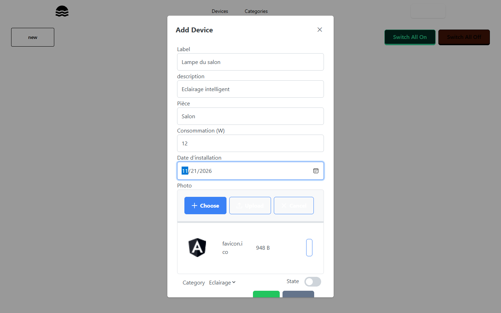
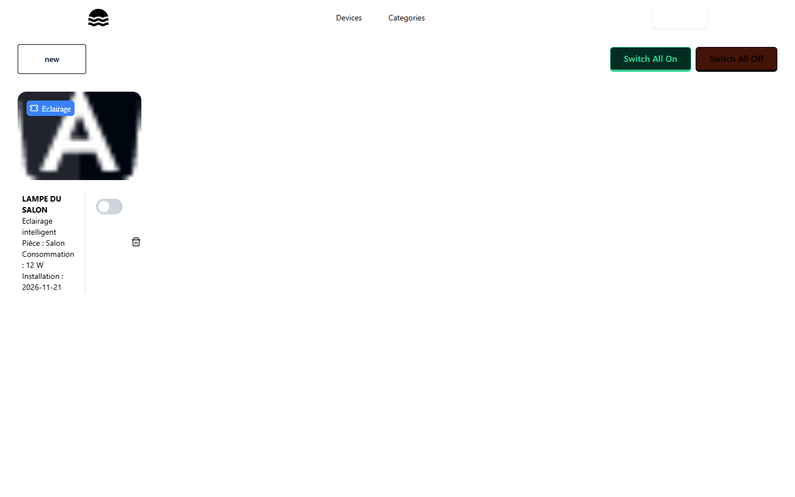
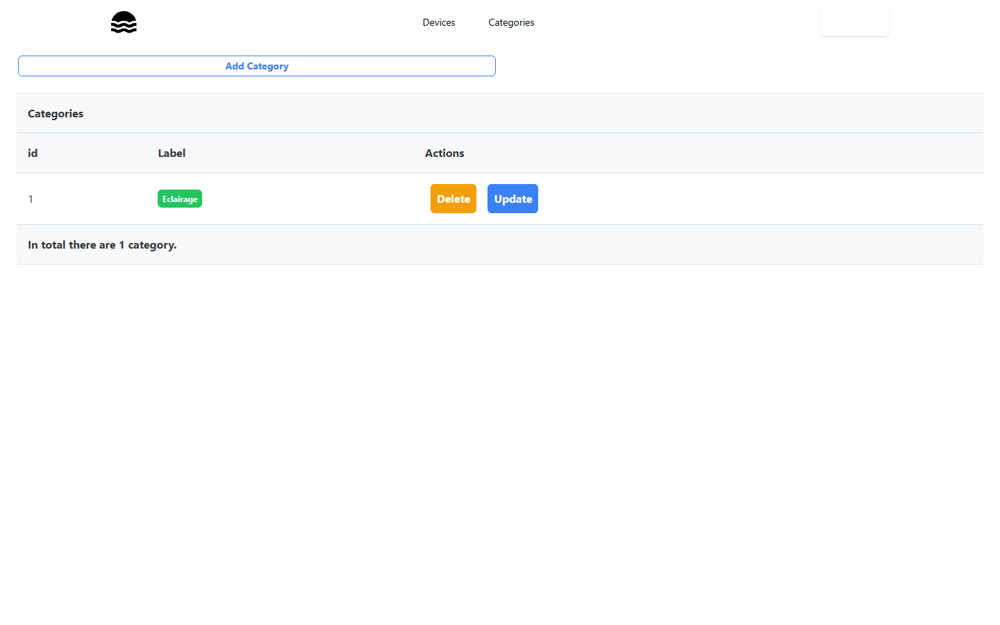

# TP — Smart Home avec Docker

**Nom et prénom :** à compléter  
**Filière / groupe :** à compléter  
**Encadrant :** à compléter  
**Année universitaire :** à compléter

Ce TP orchestre une application Spring Boot, une interface Angular, MySQL et phpMyAdmin avec Docker Compose. Le code de départ provient de [lachgar/smarthouse](https://github.com/lachgar/smarthouse).

Le backend et le frontend sont inclus dans ce dépôt, avec leurs Dockerfiles.

## Structure attendue

```text
.
├── Smart_Home_back/       # backend Spring Boot, pom.xml, src et Dockerfile
├── smartHome-front/       # frontend Angular, package.json, Dockerfile et nginx.conf
├── docker/                # modèles de configuration
├── docker-compose.yml
└── README.md
```

## Préparation

Installer Git, Docker Desktop et le plugin Docker Compose, puis démarrer Docker Desktop. Pour les tests locaux hors Docker, installer également Java 17, Maven, Node.js et npm dans les versions compatibles avec les projets.

Dans un terminal PowerShell, placer le répertoire courant à la racine du projet. Le backend écoute sur le port **8085**, et le navigateur accède à son API via `http://localhost:8085`. Le nom `mysql` est utilisé entre les conteneurs.

## Personnalisation proposée

Les appareils possèdent trois champs supplémentaires : **pièce**, **consommation électrique en watts** et **date d'installation**. Ces champs sont intégrés à l'entité Java, à l'API et au formulaire et à l'affichage Angular.

## Tests à effectuer avant le dépôt

1. Vérifier les versions installées : `docker --version` et `docker compose version`.
2. Tester séparément les projets en local selon leurs propres instructions, en configurant MySQL pour le backend. Vérifier la connexion à la base et les principales fonctions de l'interface.
3. À la racine de ce projet, exécuter :

   ```powershell
   docker compose config
   docker compose build
   docker compose up -d
   docker compose ps
   docker compose logs --tail=100
   ```

   Sur cette machine, l'antivirus intercepte les connexions HTTPS. Pour reconstruire avec son certificat local, utiliser `docker compose -f docker-compose.yml -f docker-compose.local.yml build`, puis `docker compose up -d`. Les fichiers locaux de certificat et de configuration sont ignorés par Git.

4. Vérifier que les quatre services sont démarrés et que MySQL est sain. Ouvrir `http://localhost`, utiliser les fonctions de l'application et vérifier dans l'onglet Réseau du navigateur que les appels à l'API réussissent. Ouvrir `http://localhost:8081`, se connecter avec `root` / `root` et vérifier la base `smart-house`.
5. Créer une catégorie puis ajouter et retrouver un équipement avec ses champs personnalisés. Rafraîchir la page et vérifier la persistance des données. Consulter `docker compose logs backend` ou `docker compose logs mysql` en cas d'erreur.
6. Arrêter les services avec `docker compose down`. Le volume MySQL conserve les données ; `docker compose down -v` les supprime.

Les identifiants indiqués sont destinés uniquement au TP local. Les ports 80, 3307, 8081 et 8085 doivent être disponibles. Depuis la machine hôte, MySQL est accessible sur le port 3307 ; entre conteneurs, il utilise le port 3306.

## Captures d'écran







## Dépôt GitHub

Après validation, créer un dépôt vide sur GitHub puis, à la racine du projet :

```powershell
git init
git status
git add .
git status
git commit -m "TP Smart Home avec Docker"
git branch -M main
git remote add origin URL_DE_VOTRE_DEPOT
git push -u origin main
```

Remplacer `URL_DE_VOTRE_DEPOT` par l'adresse du dépôt GitHub. Vérifier la liste des fichiers avant le commit ; ne pas inclure les dépendances générées, les secrets ni le dossier de clone temporaire. Conserver la référence au dépôt d'origine.
